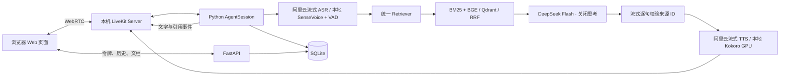

# 知声：本地知识库语音助手

支持本地运行与服务器部署。部署方式和维护命令见 [服务器部署与维护](docs/服务器部署与维护.md)。

项目逻辑和 LiveKit RAG 接入见 [项目架构与 RAG 链路](docs/项目架构与RAG链路.md)。

基于 LiveKit Agents 的知识库语音助手。浏览器通过本机 LiveKit Server 传输 WebRTC 音频，当前演示配置使用阿里云百炼流式中文 ASR/TTS，保留 SenseVoice CPU 识别和 Kokoro GPU 合成作为可选本地方案。LLM 默认使用 **DeepSeek `deepseek-flash`，关闭思考**。

## 启动

本机已经安装完成时，电脑重启后打开 PowerShell，运行：

```powershell
Set-Location -LiteralPath '.\livekits-agents-rag'
.\scripts\start.ps1 -SkipBuild
```

然后打开 <http://127.0.0.1:8000>，等待服务与模型预热就绪。脚本统一启动 Qdrant、LiveKit、Python Web API 和语音 Agent；前端构建产物由 Python 在同一地址提供。BGE 模型由 Python 自动加载，SQLite 自动打开已有数据库；语音选择云服务时不会预热本地 SenseVoice/Kokoro。当前 `.env`、模型、知识库和聊天记录都会保留。启动脚本会忽略电脑重启后过期的进程记录。

日常启动用 `-SkipBuild` 复用已有前端；修改前端代码后运行 `.\scripts\start.ps1` 重新构建。停止用 `.\scripts\stop.ps1`；修改配置后先停止再启动。

以下步骤用于首次安装：

在本目录打开 PowerShell：

```powershell
uv sync --frozen
uv run python scripts/setup_resources.py
uv run python scripts/setup_knowledge.py  # Qdrant Windows + Web UI + 中文 embedding
Copy-Item .env.example .env  # 仅首次创建；已有 .env 时保留原文件
# 填写 .env 的 LLM_API_KEY；默认模型和地址已设置为 DeepSeek。
.\scripts\start.ps1
```

打开 [http://127.0.0.1:8000](http://127.0.0.1:8000)。首次安装还需要 Node.js/npm、uv/Python 3.12、约 12 GB 可用磁盘（包含下载缓存）及下载依赖和模型的网络。默认合成使用 NVIDIA GPU 和可用驱动，CUDA 运行库随 PyTorch wheel 安装，无需单独编译 CUDA 扩展。已有资源时可用 `start.ps1 -SkipBuild` 跳过前端重建。启动脚本绑定 loopback，不需要 Docker、LiveKit Cloud 账号或公网域名。

```powershell
.\scripts\stop.ps1                    # 停止本应用进程
.\scripts\start.ps1 -SkipBuild        # 修改 .env 后重新启动
uv run pytest -q                      # 离线关键链路测试
uv run python scripts/check_speech.py  # 本地中文语音模型实际推理检查
uv run python scripts/benchmark_tts.py # 本机 TTS 测速与三个中文音色试听
uv run python scripts/check_knowledge.py # 仅验证文档/向量增删改查，不调用 LLM 或语音
uv run python scripts/check_binding.py   # 隔离测试库中验证真实 Qdrant 知识库范围，不调用 LLM 或语音
uv run python scripts/check_llm.py     # 使用真实模型检查生成与引用
uv run python scripts/check_streaming.py # 一次流式 LLM + 首句 TTS，验证音频早于全文完成
uv run python scripts/smoke_voice.py   # 合成输入的真实 WebRTC/多轮/打断验证
uv run python scripts/evaluate.py --with-llm  # 固定20题评估，会调用模型API
```

`runtime/processes.json` 记录本应用进程。停止脚本校验可执行文件及启动时间，并处理 Windows Python 虚拟环境启动器的子进程，避免误停其他程序。服务日志位于 `runtime/*.log`。Web API 文档位于 `/docs`。

## 外部资源

在线 LLM 配置为 `LLM_BASE_URL`、`LLM_MODEL`、`LLM_API_KEY`。密钥通过本地 `.env` 配置；该文件被 Git 忽略，不会发送到前端。

当前本机演示另使用阿里云语音：`STT_PROVIDER=dashscope`、`TTS_PROVIDER=dashscope`。设置 `DASHSCOPE_API_KEY`、`DASHSCOPE_WORKSPACE_ID` 和 `DASHSCOPE_REGION=cn-beijing`，业务空间和地域必须对应免费额度所在地。使用 Workspace 原生 WebSocket 接口，不经过 OpenAI 兼容语音接口。

- 识别：`DASHSCOPE_ASR_MODEL=qwen-audio-3.1-asr-flash-streaming`，16 kHz PCM、中文/英文提示、近场 VAD，断句静音默认 400 ms；持续流式识别，不逐句建立连接。
- 合成：`DASHSCOPE_TTS_MODEL=qwen-audio-3.1-tts-flash`，`DASHSCOPE_TTS_VOICE=yuxiaoyun_v3.1`，24 kHz PCM，`DASHSCOPE_TTS_RATE=1.05`；音频边生成边播放，正常任务短时复用连接，打断时取消任务并丢弃旧连接，防止旧音频串入下一次回答。
- 用量记录在 Agent 日志的 `speech_usage` 中，不包含密钥。错误只输出状态码/错误代码，避免供应商响应泄露凭据；额度或鉴权错误不会自动换到付费模型。
- 可运行 `uv run python scripts/check_dashscope.py` 做一次短句合成与识别检查，会消耗少量语音额度，不调用 LLM。结果与试听音频保存在 `runtime/dashscope-check.json`、`runtime/dashscope-check.wav`。

参考：[ASR 原生协议](https://help.aliyun.com/zh/model-studio/qwen-audio-asr-streaming-client-events)、[TTS 原生协议](https://help.aliyun.com/zh/model-studio/qwen-audio-tts-client-events)。

本地方案：将 `STT_PROVIDER=local`、`TTS_PROVIDER=local` 后重启，使用 SenseVoice Small int8 和 **Kokoro-82M-v1.1-zh 中文专用模型**，GPU 推理、模型预热、分句送出音频。模型下载约 156 MiB 压缩 ASR 与 313 MiB TTS 权重/音色，另需首次安装 CUDA 版 PyTorch。不需要语音 API Key。默认女声 `zf_001`，语速 `1.10`；可设置 `LOCAL_TTS_VOICE=zf_017` 或 `zm_010`，用 `LOCAL_TTS_SPEED` 调整速度。详见 [中文 TTS 选型与实测](docs/中文TTS选型与实测.md)。也可分别将 provider 改为 `api`，填写对应的 OpenAI 兼容语音服务配置。只有聊天 API 的供应商不能直接当作 STT/TTS 服务。

LiveKit 使用官方本地开发模式 `--dev --bind 127.0.0.1`，开发凭据 `devkey/secret`。这是本机演示配置。远程演示需配置 HTTPS/WSS、网络端口和独立服务端密钥。

## 已实现功能

- 浏览器开始/结束语音通话、静音、连接与 Agent 状态、自动重连提示、播放解锁提示。
- 中文 STT → 检索与 DeepSeek → TTS，云端/本地语音可配置，支持连续追问与 VAD 打断。
- 语音回答使用 DeepSeek SSE 流式生成，每个完整短句检查引用后立即交给 TTS；后续生成、合成和播放重叠进行。
- 默认 BM25 + BGE 中文向量检索的 RRF 混合召回；可切换纯向量、BM25、TF-IDF。
- 多知识库、独立文档管理、会话绑定；切换知识库创建新会话，检索范围在排序前过滤。
- 每库独立的助手定位、服务范围、上下文、澄清策略、回答方式和可选术语说明；支持根据资料生成可编辑草稿。
- 独立的本机 Qdrant Windows 服务与官方 Web UI；BGE-small-zh-v1.5 在 CPU 编码，512 维归一化向量。
- 浏览器上传 TXT / Markdown / 可提取文字的 PDF / DOCX，单份 10 MB；可编辑提取后的文字、删除文档，同步更新向量。
- 通用查询原文检索、知识库和文档版本隔离、资料不足说明和必要条件澄清。
- 模型返回结构化答案与实际使用的片段 ID；后端验证 ID 来自当轮召回，来源名称与原文由后端映射。
- 引用按会话、轮次和消息关联；移动窄屏通过来源弹窗查看。已打断回答保存实际转写与打断标记。
- SQLite 历史持久化、浏览器 HttpOnly cookie 所属隔离；新会话拥有独立上下文。
- 最近会话与历史会话列表可逐条确认删除，同时清除聊天、引用和指标记录，保留知识库资料；通话或回答生成期间阻止删除。
- 文档正文、旧版本与删除标记存储于 SQLite，向量存储于 Qdrant；内容哈希版本号、检索实验台。
- 模型/检索故障与无证据区分；短期房间令牌、来源检查、路径校验、服务端密钥。
- 响应与检索耗时、语音组件指标日志、关键链路测试、固定问题集评估。

## 目录与架构

```text
app/
  main.py                  FastAPI 应用组装、生命周期与前端静态资源
  config.py                共享配置
  models.py                请求、消息、引用和知识库数据结构
  store.py                 SQLite 会话与消息存储
  api/
    access.py              演示密码与登录入口
    context.py             每个应用实例的共享资源和会话锁
    dependencies.py        请求依赖与浏览器所属身份
    middleware.py          来源校验、访问保护与请求日志
    routes/
      sessions.py          会话、文字聊天、语音令牌与挂断
      knowledge_bases.py   知识库配置与助手说明草稿
      documents.py         文档上传、编辑、删除
      search.py            检索实验接口
      status.py            服务与资源状态
  conversation/
    engine.py              提示词、检索编排、生成与证据校验
    streaming.py           LLM SSE 与逐句 JSON 增量解析
  voice/
    __main__.py            python -m app.voice 启动入口
    agent.py               LiveKit Agent 与语音轮次、打断、引用事件
    providers.py           STT/TTS 服务选择与组装
    local.py               SenseVoice 与 Kokoro/VITS 本地语音适配
    dashscope.py           阿里云原生 WebSocket ASR/TTS 适配
  knowledge/
    repository.py          知识库元数据与业务配置存储
    documents.py           文档解析、正文与版本持久化
    retrieval.py           检索接口、BM25/TF-IDF 与 RRF 融合
    vector.py              Embedding 与 Qdrant 索引/查询
frontend/                   React + TypeScript + Vite + livekit-client
scripts/                    安装、启动、停止和检查脚本
evaluation/                 历史固定题集与评估记录
tests/                      API、检索、语音生命周期与权限测试
```



`main.py` 创建应用实例及其 `AppContext`，各路由通过 FastAPI 依赖取得对应实例的资源；会话锁和初始化错误状态也保存在该实例中。语音层直接调用 `conversation` 和 `knowledge`，不依赖 Web 路由。启动入口仍为 `app.main:app` 和 `python -m app.voice`，现有启动脚本与 systemd 命令无需改变。

`on_user_turn_completed` 创建轮次并保存用户消息；`llm_node` 在可取消的生成链路内完成检索与生成。语音调用 `stream_answer`，DeepSeek 设置 `stream=true`、关闭思考，按 SSE 增量读取 `{"segments":[...]}`。模型每个元素输出一个短句及该句引用，解析器在该元素闭合时立即校验，不等待整个数组或 HTTP 响应结束。仅正文进入 TTS，JSON 字段和来源 ID 不会朗读。证据使用短暂的 S1/S2 标识减小输出开销，再由后端映射回真实片段；事实句没有引用或引用不在本轮召回中时，该句会被拦截。此处校验的是来源 ID 和输出协议，不等于逐句事实正确性审核。

每个已校验短句通过 `ChatChunk` 输出，随后输出 LiveKit `FlushSentinel`，建立独立播放段。下一句生成/合成可与前一句播放重叠；沿用 SDK 的打断和音频调度，不使用独立播放队列。`conversation_item_added` 保存 SDK 实际保留的播报转写，仅关联已播放前缀所涉及的引用和追问状态。自定义 `support_turn_id` 在消息 extra 中关联轮次；每句前检查任务是否过期。打断/关闭生成器会关闭进行中的 HTTP 响应，TTS 则取消并丢弃旧连接。生成中途出错不会自动重试整段，避免重播已说内容；已说出的前缀保留，错误单独提示。文本聊天与业务配置草稿仍使用原有完整 JSON 接口。

LLM HTTP 客户端在通话内复用，证书加载在线程中预热，避免每句/每轮重新建立客户端阻塞音频循环。日志与会话指标包含 `llm_first_delta_ms`、`llm_first_sentence_ms`、`generation_ms`、流完成/取消状态和 token 用量。`scripts/check_streaming.py` 的检查报告保存在 `runtime/streaming-check.json`，检查会消耗一次 LLM 和首句 TTS 的额度，不创建通话或浏览器操作。

每次生成加入固定证据规则、当前会话的业务配置、资料标题目录和当轮召回片段，未将全部正文放进提示词。寒暄、能力介绍、告别和澄清由 LLM 结合历史理解。检索直接使用当前用户原文，不按问句前缀、字数、数字或型号补全，不做程序化别名替换，也不自动拼接上一轮问题。历史仍传给生成模型；因此只有“那怎么办”等省略问法可能召回不足，需要用户补全问题。可选术语说明仅作为当前知识库的模型语义参考。事实仍要求检索证据和有效引用。资料预览模式清楚标记“本地资料摘录”，不伪装成 LLM 回答。

## 多知识库与助手说明

在知识库页面点击“新建知识库”，填写名称和业务配置，再上传该主题的文档。一个知识库可以包含多份手册。顶部选择器决定当前知识库，切换时自动创建独立会话。文字和语音使用相同绑定逻辑；旧会话仍可从历史记录打开。

“编辑助手说明”包含助手定位、服务范围、关键上下文、澄清策略、回答方式和可选术语说明。例如 IoT 平台助手可关注协议和错误码，人事制度助手可关注员工类别和申请阶段。具体菜单、参数和步骤仍由文档证据决定。

知识库页面提供“删除知识库”与二次确认：删除自建库时清除全部文档、文档旧版本和该库的 Qdrant 向量，历史会话与引用快照保留供查看，关联会话标记为已结束。删除后自动切回默认知识库。进行中的通话或文字回答会阻止删除；向量清理失败时保留 SQLite 数据供重试。默认知识库保留作为入口，可删除其中的文档。

上传后可点击“根据资料生成草稿”：使用当前配置的 DeepSeek，读取最多 8 份文档各前 1000 字生成建议，不自动覆盖已保存配置。用户可修改并保存。没有资料时禁用生成，也可以完全手动配置。

创建会话时保存 `knowledge_base_id` 和业务配置快照。配置修改对新会话生效，已有会话保持原业务配置；文档的更新和删除则对后续检索即时生效。空知识库不会回退到其他库。知识库是本地演示空间共享的，聊天历史仍按浏览器所属隔离。

旧版自动创建的路由器默认配置可通过 `python scripts/migrate_generic_profiles.py --database runtime/support.db` 一次性迁移为通用配置。脚本只匹配原始默认名称和配置指纹，先备份 SQLite，再迁移默认配置及其会话快照；自定义配置和文档不受影响，重复运行不重复修改。新安装无需运行迁移脚本。

文档在各库内校验同名，不同库允许上传同名文件。Qdrant 共用 collection，片段 payload 带 `knowledge_base_id`；查询同时按知识库、有效文档 ID 与当前版本过滤。BM25/TF-IDF 同样在打分排序前限定片段范围。旧版单库资料及历史迁移到默认知识库，保留文档和会话 ID。

主要接口：`GET/POST /api/knowledge-bases`、`DELETE /api/knowledge-bases/{id}`、`PUT /api/knowledge-bases/{id}`、`POST /api/knowledge-bases/{id}/profile-draft`。创建会话、检索和上传传入 `knowledge_base_id`；省略时兼容旧客户端，使用 `default`。multipart 上传同样使用 `knowledge_base_id` 字段。会话绑定不提供原地修改接口，切换范围通过新建会话完成。

## 文档管理与向量数据库

打开知识库页面，可以直接上传 TXT、Markdown、PDF、DOCX。支持 UTF-8 或 GB18030 文本；PDF 需要有可提取文字，扫描版需先 OCR。打开一份文档后可编辑内容、保存并更新索引，或确认删除。PDF/DOCX 编辑的是知识库提取文本，不改写原始二进制文件。

文档正文与历史版本存于 `runtime/support.db` 的 `kb_documents` / `kb_document_versions`，Qdrant 向量存于 `runtime/qdrant/storage`。首次运行创建空知识库，文档通过网页上传或文档 API 管理，不再从项目目录导入。删除文档后不会在重启时重新出现。测试使用独立临时数据库和少量合成语料，不读取业务文档。

默认 `RAG_BACKEND=hybrid`。BGE 在 CPU 编码，Qdrant 余弦检索与 BM25 结果按 RRF 排名融合；查询只按知识库、有效文档和当前版本过滤，不从文本提取型号或版本作为硬性过滤条件。片段正文上限 360 字、相邻重叠 60 字，标题在编码时限制 80 字，为 BGE 512 token 输入预留空间。`VECTOR_MIN_SCORE=0.42` 是本演示的可调阈值，不代表置信度或通用准确率。

上传先完成 embedding 与向量写入，再发布文档新版本；更新后清除旧版本向量。检索还按数据库中的当前文档版本过滤，避免故障残留旧向量被使用。删除会移除 Qdrant 中该文档的向量，并把正文从可检索文档列表中移出；历史对话中的引用快照保留。编辑带版本校验，防止覆盖另一份更新。API 与语音进程每轮检查知识库版本，因此已有通话的后续问题也能看到变更。

数据库界面：[http://127.0.0.1:6333/dashboard](http://127.0.0.1:6333/dashboard)。collection 为 `support_knowledge`，可查看向量维度、知识库 ID、片段原文、文档名、版本与 embedding 模型。服务仅绑定 loopback，无需 Docker 或向量/embedding API Key。

`scripts/setup_knowledge.py` 从官方固定版本下载 Qdrant 1.19.2、Web UI 0.2.19 和 BGE 模型，验证二进制及权重 SHA256；模型在运行时使用本地文件。启动脚本先等待 Qdrant 就绪，再启动 API 与 Agent。API 初始化向量库，Agent 预热 embedding；未变更的向量保存在磁盘，重启无需全部重新编码。

## RAG 切换与 Dify

在语音助手顶部或检索实验台选择 BM25、向量或混合检索，会创建独立会话，随后使用同一套语音主流程和引用结构。各本地实现使用绑定知识库中的当前资料。已有历史会话保持原来的后端；演示新能力时请选择混合检索并新建通话。

Dify 适配器代码与合约测试保留，但当前会话入口已禁用 Dify：旧配置只有一个全局 dataset，无法保证多个本地知识库的范围隔离。未来接入需先建立本地知识库与 Dify dataset 的独立映射；单独填写全局 API Key 和 dataset 不会启用该入口。

## 演示建议

1. 新建一个知识库，上传本次要展示的资料，可按需填写助手说明。
2. 新建语音会话，询问一个资料明确说明的问题，查看引用原文。
3. 播报过程中开口问新问题，确认旧音频停止且旧回答标记为已打断。
4. 询问资料未说明的内容，观察说明无法确认或澄清。
5. 切换到另一个主题的知识库，确认会话使用对应资料和助手说明。
6. 静音、恢复、挂断，查看保存的历史；切换检索后端对比召回。

`evaluation/` 和部分检查脚本中的路由器问题是历史示例语料，不是运行时规则；旧评估结果不代表修改后的效果。
建议使用耳机，减少扬声器回声。真实人的口音、噪声与浏览器设备权限需要现场确认。合成输入端到端测试能验证传输和链路，但不能代替真人听感及麦克风质量测试。

## 官方资料与复用来源

- [LiveKit Agents](https://github.com/livekit/agents)：Python SDK 1.8.7，参考生命周期、节点与事件；没有修改克隆的 SDK 源码。
- [LiveKit 本地运行](https://docs.livekit.io/transport/self-hosting/local/)：Windows Server 1.13.10；下载后核对官方 SHA256。
- [LiveKit RAG 接入](https://docs.livekit.io/agents/logic/external-data/)。
- [LiveKit 官方文档 MCP](https://docs.livekit.io/reference/developer-tools/docs-mcp/)：`codex mcp add --url https://docs.livekit.io/mcp livekit-docs`。可按开发环境配置后使用。
- [DeepSeek 思考开关](https://api-docs.deepseek.com/guides/thinking_mode/)：请求 `thinking: {type: disabled}`；[JSON 输出](https://api-docs.deepseek.com/guides/json_mode/)。
- [SenseVoice Small](https://k2-fsa.github.io/sherpa/onnx/sense-voice/pretrained.html)、[Kokoro 中文模型](https://huggingface.co/hexgrad/Kokoro-82M-v1.1-zh) 与 [Kokoro 官方代码](https://github.com/hexgrad/kokoro)。
- [Qdrant 官方发布](https://github.com/qdrant/qdrant/releases/tag/v1.19.2)、[Web UI](https://qdrant.tech/documentation/web-ui/)、[BGE 模型与 CLS/归一化编码说明](https://huggingface.co/BAAI/bge-small-zh-v1.5)。
- [Dify 检索 API](https://docs.dify.ai/en/api-reference/knowledge-bases/retrieve-chunks-from-a-knowledge-base-test-retrieval)。

前端使用 React、Vite、LiveKit Client 和 Lucide 图标。项目包含语音适配器、知识库管理、应用界面和对话编排。模型文件保留官方来源，分发时按相关项目与模型页的许可说明处理。

## 开发与验证

架构与运行方式见本文件；AI 辅助编程记录见 `docs/AI开发反思.md`；固定题集和输出见 `evaluation/`。测试与性能记录以实际生成的报告为准。`runtime/`、模型、依赖缓存和 `.env` 均不进入源码仓库。
