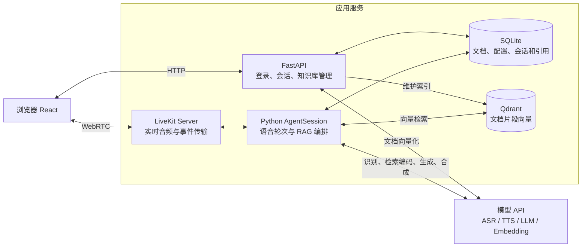
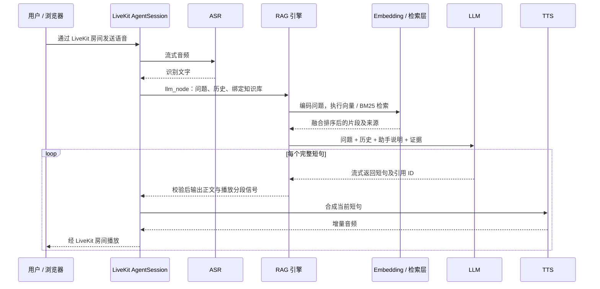

# 知声：项目架构与 RAG 链路

知声是一个支持多知识库的中文语音助手：用户上传资料并选择知识库，通过浏览器实时对话，回答同时展示资料引用。LiveKit 负责实时音频和对话调度，应用代码负责检索、提示词、生成及引用关联。

## 1. 整体架构

模型服务可独立配置。云端方案使用阿里云 ASR、TTS、Embedding 和 DeepSeek LLM；本地方案支持 SenseVoice、Kokoro 和 BGE。SQLite、Qdrant、Web 服务和 LiveKit Server 由应用所在机器运行。

## 2. 在 LiveKit 中接入 RAG

**核心接入点是自定义 `Agent.llm_node()`：在生成回答前检索资料，再把证据交给 LLM。** 当前实现每轮主动检索，不依赖模型决定是否调用检索工具。

| 阶段 | 项目中的处理 |
| --- | --- |
| 建立通话 | FastAPI 创建业务会话，签发房间令牌，并携带会话 ID 调度指定 Agent。浏览器与 Agent 加入同一个 LiveKit 房间。 |
| 接收问题 | `AgentSession` 结合 VAD 和 ASR 获取用户话语。`on_user_turn_completed()` 保存本轮文字、历史和轮次 ID。 |
| 检索资料 | 自定义 `llm_node()` 调用 `SupportEngine.prepare()`，在会话绑定的知识库中检索，得到带来源的文档片段。 |
| 生成回答 | `stream_answer()` 组合通用规则、知识库助手说明、历史、当前问题及检索证据，向 LLM 发起流式请求。 |
| 合成播报 | 每个完整短句通过引用校验后，作为 `ChatChunk` 输出；`FlushSentinel` 划分播放段，由 LiveKit 调度 TTS 和播放。 |
| 保存结果 | 根据 SDK 实际保留的播报转写保存回答、引用和指标，并向浏览器发送文字与状态事件。 |

因此，RAG 并不是改造 LiveKit 的音频传输，而是在其可替换的生成节点中加入应用自己的检索和生成逻辑。

## 3. 一轮语音对话的链路

- **流式响应**：LLM 使用 SSE 增量输出，模型按短句返回结构化结果。应用无需等全文生成完毕，下一句生成、合成可与前一句播放重叠。
- **打断处理**：用户开口后，LiveKit 停止旧播报；应用通过轮次标记丢弃过期结果，并取消旧生成和合成任务。历史保留实际已播报部分。
- **引用约束**：事实句必须带当轮召回中的来源 ID，浏览器展示对应原文。这能校验引用来源，但不等于自动证明每句话都被证据充分支持。

## 4. 知识库与检索逻辑

**文档入库**：上传 → 提取文字 → 切分片段 → Embedding → 写入 Qdrant → 发布 SQLite 文档版本。修改、删除文档会同步维护索引。

**问题检索**：默认使用混合检索。BM25 负责字面匹配，向量检索负责语义匹配，两路结果通过 RRF 排名融合，选取靠前片段用于生成。也可以切换纯向量、BM25 或 TF-IDF。

**范围隔离**：会话绑定 `knowledge_base_id`，检索限定在该知识库的有效文档和当前版本中。切换知识库会创建新会话，避免跨库混用资料。

**主题适配**：每个知识库可配置助手定位、服务范围、澄清策略和回答方式。配置在创建会话时保存快照，具体事实仍以检索证据为准。没有路由器型号等领域专用规则；检索使用当前用户原文，历史用于 LLM 理解，因此省略式追问可能需要补充完整问题。

**删除与历史**：删除自建知识库会清理文档、旧版本和向量，历史会话与引用保留供查看；进行中的通话或回答会阻止删除。

## 5. 代码阅读入口

| 目录 / 文件 | 职责 |
| --- | --- |
| `app/main.py`、`app/api/` | 应用组装、登录保护、会话与知识库接口。 |
| `app/voice/agent.py` | LiveKit 接入、`llm_node()`、播放分段、打断与语音历史。 |
| `app/conversation/` | 提示词、检索编排、LLM 流式解析及引用校验。 |
| `app/knowledge/` | 文档与配置存储、Embedding、Qdrant、稀疏检索和融合。 |
| `app/store.py`、`frontend/` | 会话持久化，以及语音交互、文档管理和引用展示。 |

文字聊天复用相同的知识库绑定、检索和证据规则，通过 HTTP 返回回答；语音对话使用 LiveKit 和逐句流式播报。
